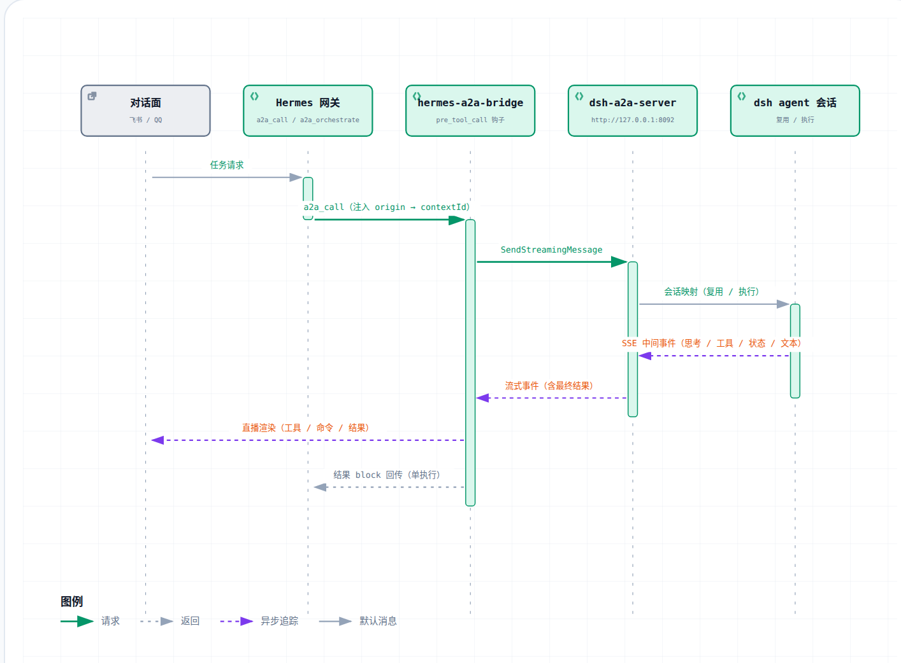

# hermes-a2a-bridge

> **已合并（2026-10-19）**：本库并入 [`dsh-hermes-link`](https://github.com/ArtomYuan/dsh-hermes-link)
> ——桥与服务端「一个产品」（包名与安装路径不变，版本自 0.10.0 起单号锁步）。本库保留
> 0.9.0 及更早的历史与 tag（冻结基线 `v0.9.0`），后续开发在新库。


[English](README.en.md) | **简体中文**

Hermes 侧接入 dsh A2A server 的桥插件：把 dsh 任务的执行过程实时直播到飞书 / QQ，
并把「一个 Hermes 对话 ↔ 一个 dsh 会话」的上下文连续性落到 `contextId` 上。

## 效果展示

### 直播流样式

投递一个 dsh 任务后，本插件边消费 SSE 流边把中间进度实时推回消息面。v0.7.0 起
**彻底改为纯文本行**：一轮内的工具步骤与思考渲染为一条 **dsh 行形态**的过程组
消息，逐行复刻 dsh 客户端「工作步骤展示」的行结构与图标（组头 `⌄` / 步骤行 `▸` /
思考行 `✦`）。用户在飞书 / QQ 里看到的完整直播序列大致如下（下例为 `standard` 档，
即当前生产 dsh 的默认档位；过程组与收束行各为一条消息）：

```text
⌄ 执行了命令，已读取文件，已搜索代码等
▸ 运行命令 · 查看提交
▸ 读取 · /tmp/a
▸ 搜索文件内容 · foo
▸ 运行命令 · echo 2
▸ 编辑 · /tmp/a
▸ 运行命令 · echo 3
▸ 写入 · /tmp/b
▸ 运行命令 · echo 4
✦ 思考 · 我先把目录结构列出来确认范围，再决定改哪几个文件。
```

```text
▸ 已完成，用时 12秒
```

上两段分别是 `consumer.render_process_group(members, "standard")` 与
`consumer.render_turn_close("completed", 12)` 的**实际输出**（非手写）。其中：

- **组头行** `⌄ <processTitle>`：`⌄` 是 dsh `IconChevronDown` 的文本等效；`processTitle`
  按工具类别的**出现次数降序**合成（1 类用完成文案、2 类 `A并B`、3 类 `，` 连接、
  >3 类取前 3 加 `等`、无工具时 `已完成分析`；思考不计入）。
- **步骤行** `▸ <工具标题> · <摘要>`：一行一步、无编号；标题取 dsh `tool.title.*`，
  摘要取 dsh `deriveSummary`（如 `description` 优先于 `command`）。
- **思考行** `✦ 思考 · <首行>`：`compact` 只出 `✦ 思考`，`verbose` 出全文。
- **收束行** `▸ 已完成`（或 `▸ 已完成，用时 <n>秒` / `▸ 处理失败` / `▸ 已停止`）：
  一轮一条，独立于过程组。`turn_start` 不再有 `🚀 第 N 轮` 行，`status` 终态也不再
  有 `✅ 完成` / `❌ 失败` / `⚠️ 已取消` 行——信息由收束行承载。

四档（`compact` / `standard` / `detailed` / `verbose`）都是这一个过程组，差异只在
**组内密度**：`compact` 仅组头 + `✦ 思考`（无步骤行、无预览）；`standard` 步骤行 +
思考首行预览；`detailed` 再加结果体（首行，缩进 2 空格）；`verbose` **不出组头**，
步骤行摘要不截断、思考与结果全文（续行缩进 2 空格）。
**既无工具步也无思考的轮次不发组**；只有思考、无工具时发一个只含思考行的组
（`compact` 为 `⌄ 已完成分析` + `✦ 思考`）。组头**不带轮次号**。

长文本超过网关单条上限时按**纯文本换行边界**分块，块间以 `⏩ 续` 提示衔接（纯文本分块，不存在跨块断裂问题）。

### 结果送达（普通 markdown，不截断）

任务结束时，本插件把最终结果以普通 markdown 主动送达消息面：
`📬 **dsh 任务完成，结果如下**（用时 …）` 头行 + 空行 + **结果原文**（不截断，自带
markdown 照常渲染；v0.7.0 起**一律为纯文本正文**）。超长（>8000）按换行边界分块，
块间 `⏩ 续`；无文本输出时只有头行。

```text
📬 **dsh 任务完成，结果如下**（用时 1 分 30 秒）

<结果原文>
```

### 显式 `context_id` 也会直播（v0.5.1）

`pre_tool_call` 的拦截条件为 `a2a_call` + `collector.enabled` + 目标为 dsh +
`message` 非空；直播 origin 取「调用方显式给出的 `context_id`」**优先**，否则取当前
消息面 origin。因此**显式携带 `context_id` 的调用同样会被拦截并直播**——v0.5.0 及
更早这类调用会被放行、直播完全不启动，这是 v0.5.1 修复的行为。

取舍：带显式 `context_id` 的调用由**同步**变为**异步**（秒回「⏳ 已受理」回执 →
后台执行 + 过程直播 → 完成后结果自动送达本对话）；调用方给出的 `context_id`
**原样采用、不被覆盖**，因此消息仍落在同一会话。

排查：若某会话没有直播消息，先确认该次 `a2a_call` 是否被拦截——被拦截时工具结果为
「⏳ 已受理」回执（日志形如 `Tool a2a_call returned error {"error":"[dsh · context …`）；
未被拦截时日志为 `tool a2a_call completed (…s, … chars)`。详见
[CONFIGURATION.md](CONFIGURATION.md)「排查：某会话为何没有直播消息？」。

### `context_id` 形态与解析失败告警（v0.7.1）

投递目标从 `context_id` 派生出 `platform/chat_id[/thread_id]`。v0.7.1 起接受两种形态：

| 形态 | 例子 | 处理 |
|---|---|---|
| 标准斜杠 | `feishu/oc_adb…/omt_19d3…`、`feishu/oc_adb…` | 直通 |
| 拼接（`a2a_list` 展示的持久化会话名） | `feishuoc_adb…omt_19d3…`、`feishuoc_adb…`、`oc_adb…omt_19d3…` | 归一化为 `feishu/oc_adb…/omt_19d3…`（无平台前缀时补 `feishu`） |

**两类形态都归一化到同一 `platform/chat_id/thread_id`**，因此落到同一个 dsh 会话与
同一个飞书会话。拼接形态此前会让 `chat_id` 解析为空，导致**直播静默、最终结果不送达，
且回执仍承诺「过程直播中」**（2026-10-10 03:55:32 事故）——v0.7.1 修复。

**解析不出目标时不再静默**：

- `logger.warning` 大声告警，含**原始串**与**失败原因**（`_on_pre_tool_call` 与
  `_stream_dsh_call` 两处都会告警；后者即原爆点）；
- 受理回执改为显式警告，**不再出现「过程直播中」的幽灵承诺**：
  `[dsh · context …] ⚠️ 会话标识无法解析（未能得出 platform/chat_id：…），本次不直播、结果仅落工作区。`
- 任务本身仍会执行，报告落工作区；「显式优先、不覆盖调用方意图」语义不变。

日志自查：`hook stream dsh` 行末尾的 `live=True/False` 标注本次是否真会直播。

### 直播档位与开关

过程展示与中间事件推送均可调整：`collector.live_detail` 控制**直播过程组的档位**
（四档 `compact` / `standard` / `detailed` / `verbose`，与 dsh「工作步骤展示」
一一对应；默认 `follow-dsh` 跟随 dsh 当前档位）；`collector.events` 控制事件流开关
（关 = 安静模式，只推最终结果，**优先于档位**）；dsh 行形态本身固定，不再单独暴露
开关。两者均可在 Dashboard「插件管理」
页的「A2A 直播开关」面板点选或下拉（即时生效）——详见
[CONFIGURATION.md](CONFIGURATION.md)。

## 卡片直播（v0.7.2 起；v0.7.3 全内容卡片化，默认关）

`collector.card`（默认 `off`，不改任何既有键）：设为 `panel` 时 **dsh 流出的全部内容都
用飞书卡片 JSON 2.0 承载**——过程组为**折叠面板**（一组一块、默认折叠），叙述文本为
**叙述卡**（无折叠、无标题），收束行为**收束小卡**，最终结果为**结果卡**（📬 头行 +
正文）。四档语义与文本版**逐字一致**（同一套文案算法）；Hermes 自身消息不经本插件、
保持普通格式。每卡 ≤30 KB / ≤200 元素，超限按行 / 步骤行边界切卡并标注「（续）」/
「⏩ 续」。卡片是增强层：**发送失败一律回落为同内容的文本行**，不丢信息。详见
[CONFIGURATION.md](CONFIGURATION.md)「卡片直播（collector.card，v0.7.2 起；v0.7.3
扩到全内容）」。

同时修正**组边界**：出现助手叙述文本即断组（对齐 dsh），「工具→叙述→工具→叙述」
现在产出 **2 个过程组 + 2 段叙述**，不再压成一组。

## 交互问答桥接（v0.8.0 起，§2.6）

dsh 在任务中途用 `ask_user_question` 提问时，问题会以**飞书 2.0 交互卡**投到
**发起该任务的那条线**：题干 + 选项按钮 + 自由输入框 + 「提交」/「跳过」。点击
**同进程直连**回桥（不落盘、不轮询），作答经 **A2A 原生 `input-required` + `taskId`
续投**写回 dsh 会话，任务当场续跑；卡片就地变为「已作答 / 已跳过」。

- **不限时**：问答全程零超时（已定死）。挂起期间任务停在 A2A `INPUT_REQUIRED`，
  `tasks/get` 可查「哪条任务在等哪道题」；首条流在挂起处收束，**等待期不占长连接**。
- **缺省＝现状**：不改任何配置键；`collector.enabled=false` 时整条通路不被触发。
  另外，服务端**只认领显式声明过问答能力**的调用方的提问（桥在首投报文的
  `metadata` 里带 `x-dsh-user-questions: true`），未声明的调用方行为与升级前一致。
- **多问题逐题**：一次提问含多道题时逐题一卡；`multi_select` 目前不做勾选组件，
  卡面标注「可多选」并支持在输入框用顿号 / 逗号分隔多项（详见 `qna.py` 末尾「已知边界」）。
- **零悬挂**：只有「作答 / 跳过 / 槽位收场」三种出口。发卡未真正送达、长连接未就位、
  槽位收场、处理异常一律以「跳过」续投（服务端把该提问以中止收口），任务绝不留在
  没有出路的等待里。
- **需配套**：`dsh-a2a-server` ≥0.6.0 与飞书适配器正式补丁（`hermes_ask_action`
  命名空间 + 处理器注册表 + `is_ws_ready()`，见 `~/.hermes/docs/hermes/custom-patches.md`）。
  适配器补丁未打时，桥会在直播起手时响亮告警；点击分支由适配器侧如实换卡，不伪造成功。

## 工作区与沙箱档参数（v0.9.0 起，§2.1/§2.4）

`a2a_call` 可带两个可选参数，随首投报文的 metadata 传给服务端：

- `workspace`：工作区**名字**（现有工作区按 title / 目录名精确匹配；查无则建）或**绝对路径**；
- `sandbox`：`read-only` / `workspace-write` / `danger-full-access`（落到该会话的权限预设，
  与 GUI 手切同一条写路径）。

**不带参数＝现状**（通用区、当前档位）。参数只在流式投递路径生效
（`collector.enabled=true` + dsh 目标）；不满足时**明确 block 并说明**。校验分两层：
非法档位 / 空工作区名由桥立即 block，更细的工作区形状规则由服务端校验（任务 FAILED，
**失败原因会送回本线**）。同一对话里「带 / 不带 workspace」会落到两个会话（跨调用记住
选择属于 §2.2，本轮未做，故应每次带上）。细节（含「读不限制、只圈写」的口径）见
[CONFIGURATION.md](CONFIGURATION.md)「请求级选项：工作区与沙箱档」。

## 流程图



## 与 dsh-a2a-server 的关系

本插件与 [dsh-a2a-server](https://github.com/ArtomYuan/dsh-a2a-server) 并非强绑定，可按需组合：

| 组合 | 能实现 |
| --- | --- |
| 只用 dsh-a2a-server | 暴露标准 A2A 接口，任意 A2A 客户端可直接调用 |
| 只用本插件 | 不适用——本插件依赖 dsh-a2a-server 作为服务端 |
| 两者一起用 | 完整体验：任务投递 + 过程直播（dsh 行形态过程组 + 收束行）+ 会话连续性（一个对话一个 dsh 会话）+ 单执行 |

## 安装说明

1. 克隆插件到插件目录：

   ```sh
   mkdir -p ~/.hermes/plugins
   git clone https://github.com/ArtomYuan/hermes-a2a-bridge ~/.hermes/plugins/hermes-a2a-bridge
   ```

2. 在 `~/.hermes/config.yaml` 启用插件：

   ```yaml
   plugins:
     enabled:
       - hermes-a2a-bridge
   ```

3. 配好 dsh peer（指向 dsh-a2a-server）：

   ```yaml
   a2a_agents:
     dsh:
       url: http://127.0.0.1:8092
       auth:
         type: bearer
         token: <与 dsh 侧 A2A_SERVER_TOKEN 同一把>
   ```

4. 重启 Hermes 网关生效（方式取决于你的部署）：

   ```bash
   # 示例：systemd 用户级服务
   systemctl --user restart hermes-gateway
   ```

## 直播开关（Dashboard 即时生效）

插件加载后，直播的三个开关——`collector.enabled`（总开关）/ `collector.events`
（中间事件推送）/ `collector.live_detail`（直播档位，下拉 5 选项：跟随 dsh / 简洁 /
标准 / 详细 / 完全展开）——可在 Hermes
Dashboard「插件管理」页顶部的「A2A 直播开关」面板直接
点选或下拉，保存**即时生效（无需重启网关，热读）**。后端端点
`GET/POST /api/plugins/hermes-a2a-bridge/collector` 严格校验后写回
`plugins.entries.hermes-a2a-bridge.settings.collector.*`（保留条目顶层
`allow_tool_override` 与其它所有键；POST 容忍旧键 `code_blocks` 作为遗留
`content` 的 deprecated 别名）。首次部署面板需重启一次 dashboard 进程。
详见 [CONFIGURATION.md](CONFIGURATION.md)「直播消费者」。

## 链接

- 详细配置与机制说明：[CONFIGURATION.md](CONFIGURATION.md)
- 变更记录：[CHANGELOG.md](CHANGELOG.md)
- 许可证：GPL-3.0（见 `LICENSE`）——本项目为独立自研插件。
